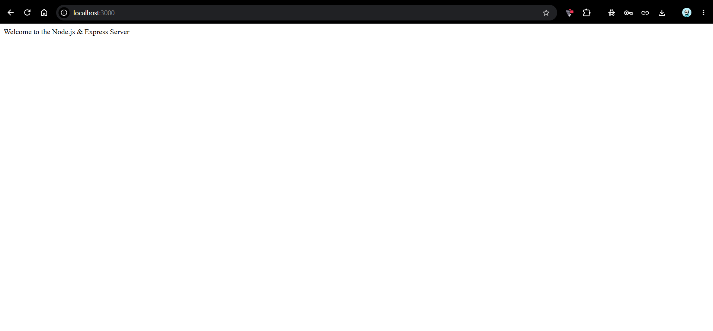
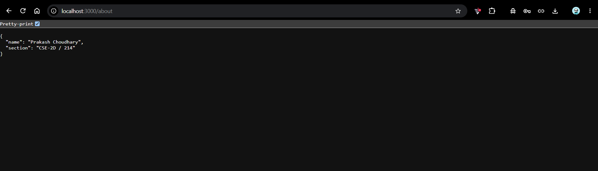
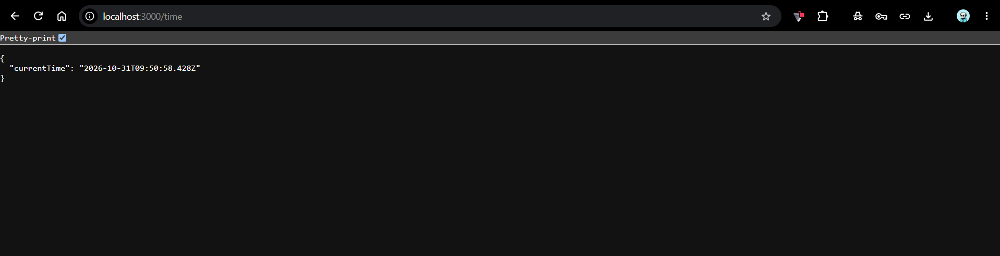
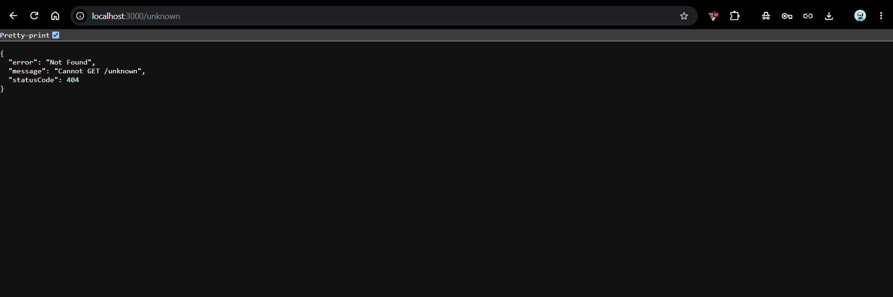

# Lab 1: Node.js and Express server

**Name**: Prakash Choudhary 
**Registration Number**: 252U1R1202 
**Section**: CSE-2D / 214  

**Live Link**: [https://bdf-labreport01-252u1r1202-prakashc.vercel.app/](https://bdf-labreport01-252u1r1202-prakashc.vercel.app/)

---

## How to Run

### 1. Prerequisites
- Node.js (v18 or higher)
- npm

### 2. Installation
Navigate into the `lab-01` directory and install project dependencies:
```bash
cd lab-01
npm install
```

### 3. Environment Variables
Create a `.env` file in the root of `lab-01/` if custom port configuration is desired:
```env
PORT=3000
```
*(Note: Defaults to port 3000 if not supplied)*

### 4. Running the Server
To run the primary Express server:
```bash
npm start
```

To test the native Node.js HTTP implementation:
```bash
npm run start:http
```

To run the automated endpoint route tester:
```bash
npm test
```

---

## Endpoints

| Method | Path | Status Code | Description |
| :--- | :--- | :--- | :--- |
| `GET` | `/` | `200 OK` | Returns a welcome greeting text |
| `GET` | `/about` | `200 OK` | Returns JSON containing student name and section |
| `GET` | `/time` | `200 OK` | Returns current server date and ISO timestamp |
| `*` | Any unknown path | `404 Not Found` | Fallback error handler for undefined routes |

---

## Screenshots

### 1. Root Endpoint (`GET /`)


### 2. About Endpoint (`GET /about`)


### 3. Time Endpoint (`GET /time`)


### 4. 404 Error Handler (`GET /unknown`)


---

## Notes: Problems Faced and Solutions
- **Port Conflicts**: Port 3000 was occasionally in use; resolved by configuring dynamic fallback via `process.env.PORT || 3000`.
- **404 Order of Execution**: Express matches routes sequentially; the 404 handler was placed at the very bottom of the middleware chain to ensure defined routes resolve first.

---

## Viva Preparation Summary
1. **What is the difference between `package.json` and `node_modules`?**  
   `package.json` contains metadata, scripts, and lists the required package versions (manifest), while `node_modules/` contains the actual installed third-party code and binaries.
2. **What does `app.listen` do?**  
   It binds the Express application to a specific network port on the host machine and listens for incoming HTTP requests.
3. **What do request (`req`) and response (`res`) represent?**  
   `req` represents the incoming HTTP request stream containing headers, body, parameters, and query data. `res` represents the outgoing HTTP response stream used to return status codes, headers, and payloads back to the client.

