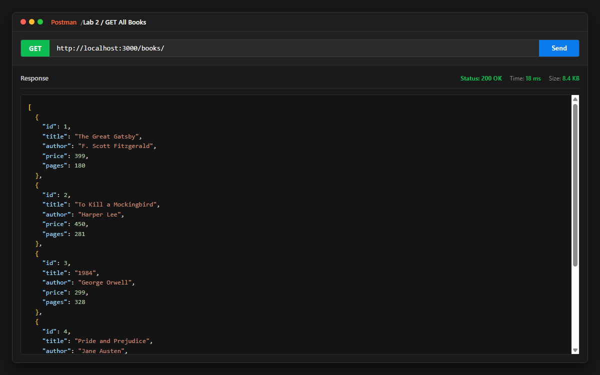
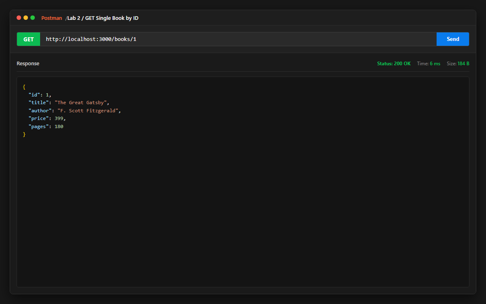
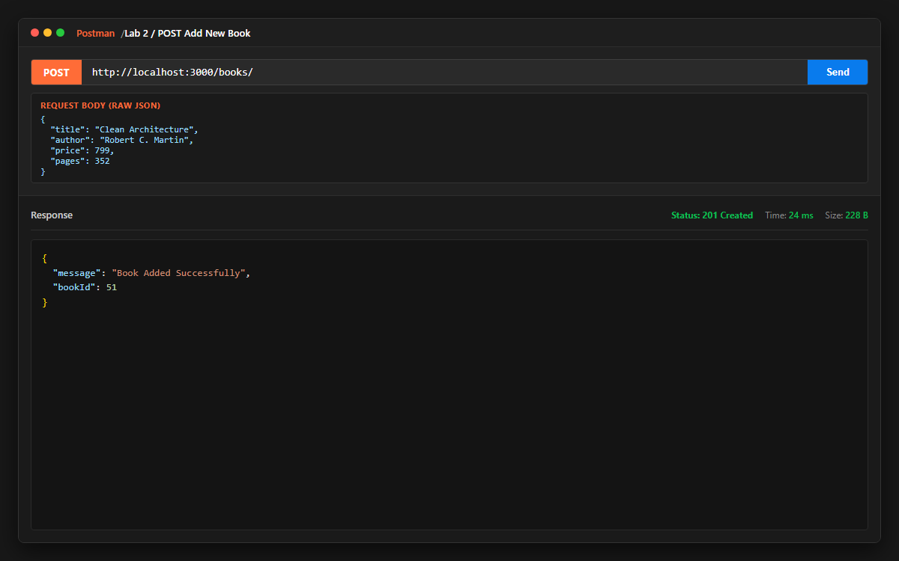
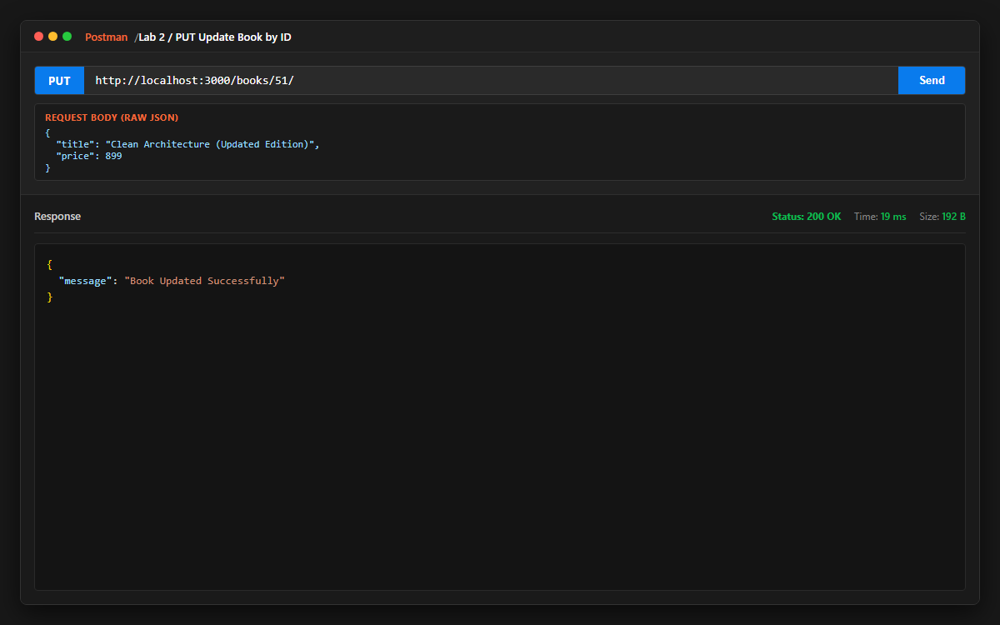
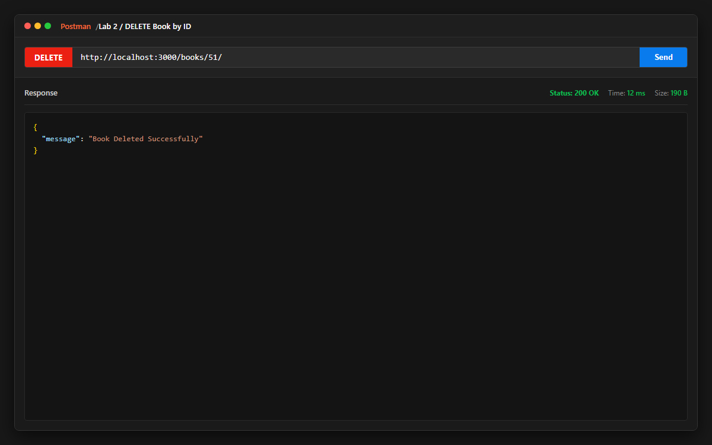
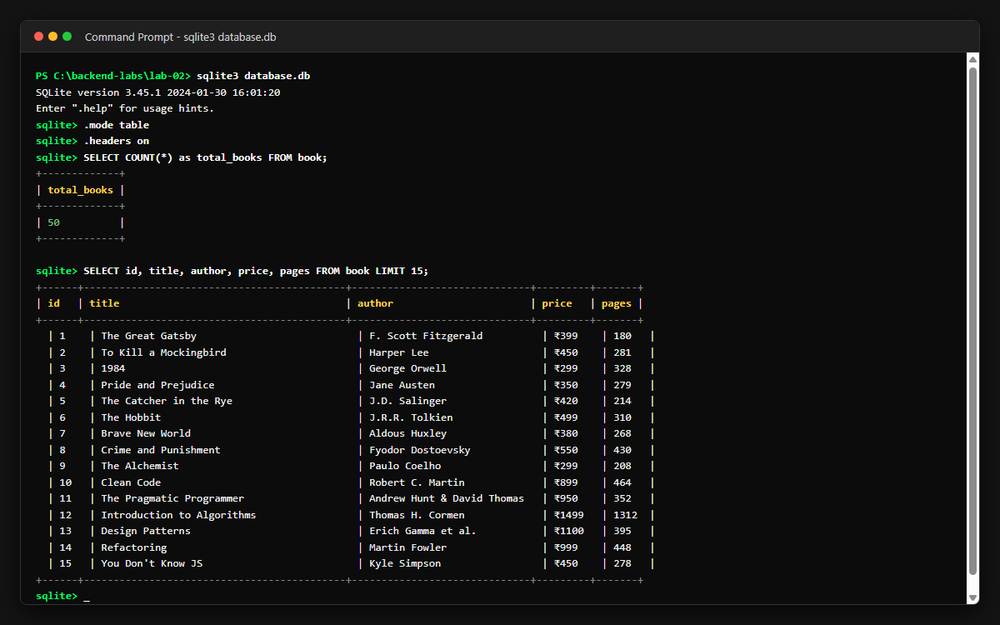

# Lab 2: SQLite database and CRUD routes

**Name**: Prakash Choudhary  
**Registration Number**: 252U1R1202  
**Section**: CSE-2D / 214  
**Course**: Backend Development Fundamentals (Year II Term II)  
**Faculty**: Sai Siva Teja Chintakrindi  

**Live Link**: [https://bdf-labreport02-252u1r1202-prakash.vercel.app/](https://bdf-labreport02-252u1r1202-prakash.vercel.app/)

---

## How to Run

### 1. Prerequisites
- Node.js (v18 or higher)
- npm

### 2. Installation
Navigate into the `lab-02` directory and install project dependencies:
```bash
cd lab-02
npm install
```

### 3. Environment Variables
Create a `.env` file in the root of `lab-02/` if custom port configuration is desired:
```env
PORT=3000
```
*(Note: Defaults to port 3000 if not supplied)*

### 4. Running the Server
To run the server in standard production mode:
```bash
npm start
```

To run the server in development mode with `nodemon` (auto-restarts on code changes):
```bash
npm run dev
```

### 5. Running the Automated Route Tester
To run the automated test suite testing all 5 CRUD operations:
```bash
npm test
```

---

## Endpoints

| Method | Path | Status Code | Description |
| :--- | :--- | :--- | :--- |
| `GET` | `/` | `200 OK` | Returns welcome message and available API endpoints |
| `GET` | `/books/` | `200 OK` | Retrieves an array of all books from the database |
| `GET` | `/books/:bookId/` | `200 OK` / `404 Not Found` | Retrieves a single book by its ID |
| `POST` | `/books/` | `201 Created` / `400 Bad Request` | Adds a new book to the database |
| `PUT` | `/books/:bookId/` | `200 OK` / `404 Not Found` | Updates existing book details by its ID |
| `DELETE` | `/books/:bookId/` | `200 OK` / `404 Not Found` | Deletes a book by its ID from the database |
| `*` | Any unknown path | `404 Not Found` | Fallback error handler for undefined routes |

---

## Database Schema

Table name: `book`
```sql
CREATE TABLE IF NOT EXISTS book (
  id INTEGER PRIMARY KEY AUTOINCREMENT,
  title TEXT NOT NULL,
  author TEXT NOT NULL,
  price INTEGER NOT NULL,
  pages INTEGER NOT NULL
);
```

The database comes pre-seeded with **50 diverse books** across computer science, classic literature, science fiction, and non-fiction.
To reset or re-seed the 50 books anytime:
```bash
node seed.js
```

---

## Screenshots

### 1. Get All Books (`GET /books/`)


### 2. Get Single Book (`GET /books/:bookId/`)


### 3. Add New Book (`POST /books/`)


### 4. Update Book (`PUT /books/:bookId/`)


### 5. Delete Book (`DELETE /books/:bookId/`)


### 6. SQLite Database Table View / CLI


---

## Notes: Problems Faced and Solutions

- **Asynchronous Database Connection**: Express must not begin accepting requests before the SQLite connection is established. Resolved by implementing an async `initializeDBAndServer()` function that connects to SQLite first and only invokes `app.listen()` once the database connection succeeds.
- **SQL Injection Prevention**: Directly interpolating user inputs into SQL strings exposes the database to SQL injection attacks. Resolved by using parameterized queries with `?` placeholders for all dynamic parameters in `SELECT`, `INSERT`, `UPDATE`, and `DELETE`.
- **Handling Non-existent Records for PUT and DELETE**: Attempting to update or delete a non-existent `bookId` should not return a generic success. Resolved by checking whether the record exists first and returning a clear `404 Not Found` status.
- **Serverless SQLite Ephemerality**: SQLite stores data in a local file (`database.db`). In serverless cloud platforms (like Vercel), the filesystem is ephemeral, so persistent multi-instance production environments typically require hosted SQL services (e.g. Turso / Supabase / PostgreSQL) or persistent container volumes (e.g. Render Web Service).

---

## Viva Preparation Summary

1. **Why await the database call?**  
   Database queries (reading and writing to disk) are asynchronous I/O operations that take variable amounts of time. Using `await` pauses function execution until the database operation completes, ensuring data is available before sending the HTTP response and preventing unhandled promise rejections.

2. **What is SQL injection and how do placeholders prevent it?**  
   SQL injection is a critical security vulnerability where an attacker injects malicious SQL statements via input fields to read, modify, or drop database contents. Placeholders (`?`) prevent this by separating the SQL command structure from user input data; the SQLite engine treats placeholder values strictly as literal values rather than executable SQL code.

3. **When is PUT used instead of POST?**  
   `POST` is used to create a new resource where the server assigns the identifier (non-idempotent operation). `PUT` is used to replace or update an existing resource at a specific target URI (`/books/:bookId/`), and is idempotent (sending the same `PUT` request multiple times results in the same resource state).

