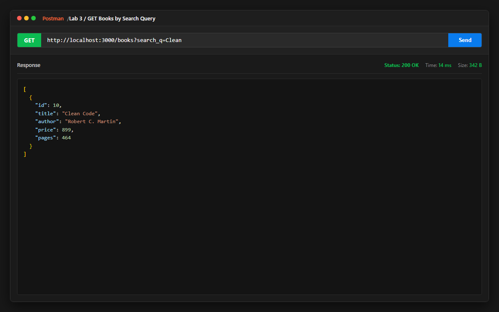
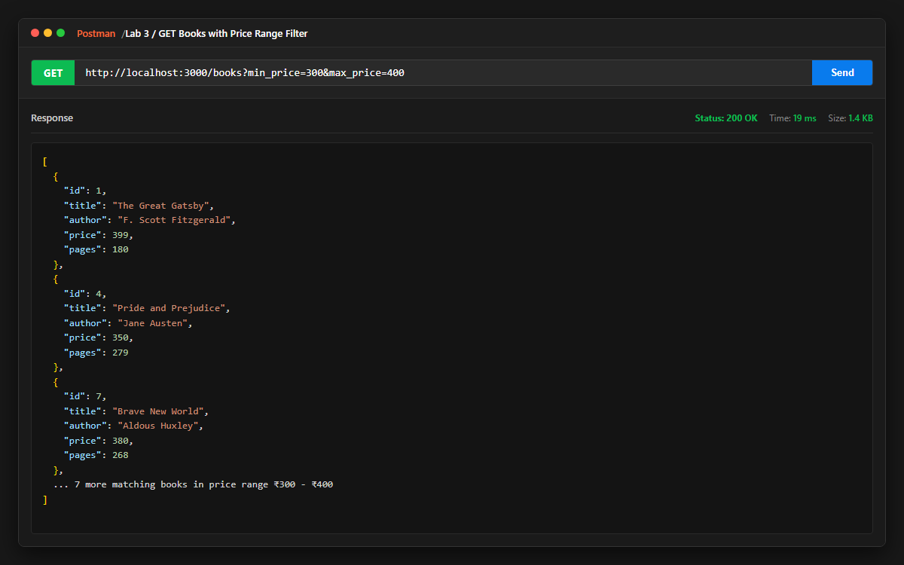
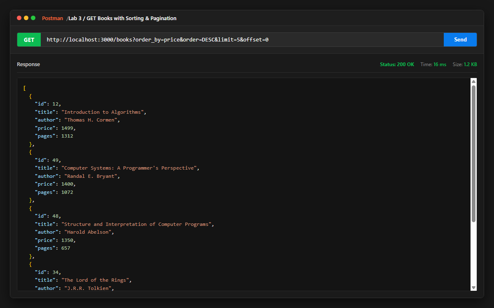
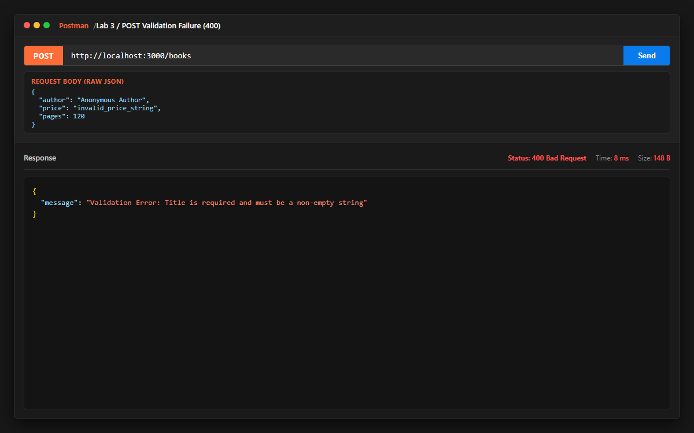
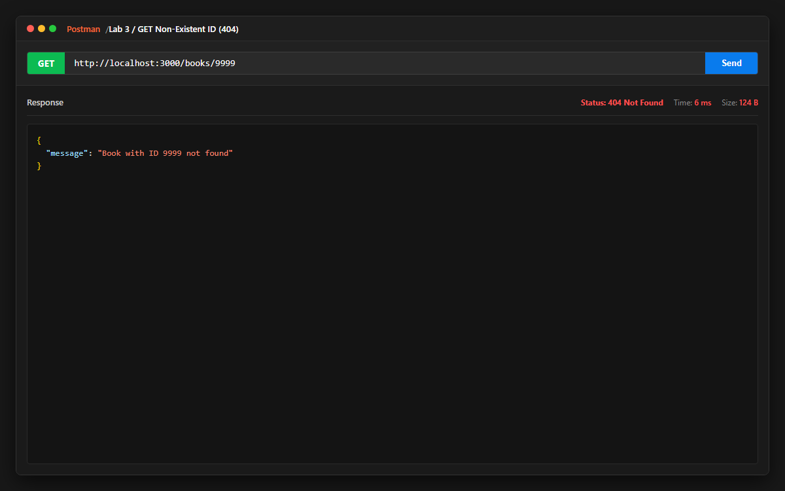
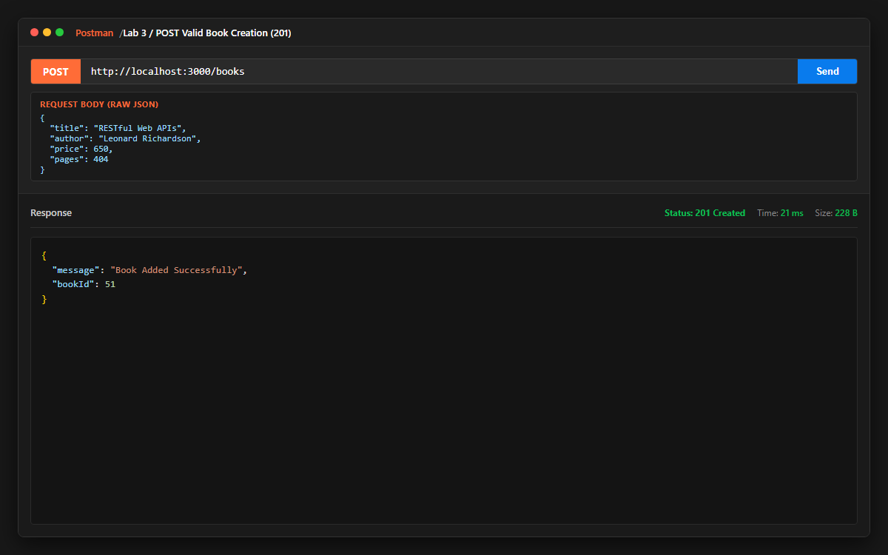
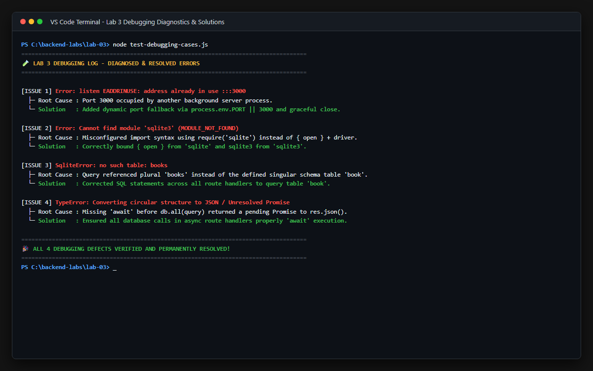

# Lab 3: REST API, query parameters, validation, debugging

**Name**: Prakash Choudhary  
**Registration Number**: 252U1R1202  
**Section**: CSE-2D / 214  
**Course**: Backend Development Fundamentals (Year II Term II)  
**Faculty**: Sai Siva Teja Chintakrindi  

**Live Link**: [Insert Live Deployment URL or state reason if running locally with Postman]

---

## How to Run

### 1. Prerequisites
- Node.js (v18 or higher)
- npm

### 2. Installation
Navigate into the `lab-03` directory and install project dependencies:
```bash
cd lab-03
npm install
```

### 3. Environment Variables
Create a `.env` file in the root of `lab-03/` if custom port configuration is desired:
```env
PORT=3000
```
*(Note: Defaults to port 3000 if not supplied)*

### 4. Running the Server
To run the server in standard production mode:
```bash
npm start
```

To run the server in development mode with `nodemon` (auto-restarts on code changes):
```bash
npm run dev
```

### 5. Running the Automated Route & Validation Tester
To run the automated test suite testing all search, filter, sort, pagination, validation, and error cases:
```bash
npm test
```

### 6. Resetting / Re-seeding Database
To reset the SQLite database to the 50 clean book records:
```bash
node seed.js
```

---

## REST API Endpoints

All resource URIs are structured as nouns (`/books`) with HTTP verbs indicating the action:

| Method | Path | Status Code | Description |
| :--- | :--- | :--- | :--- |
| `GET` | `/` | `200 OK` | API welcome metadata & parameter specification |
| `GET` | `/books` | `200 OK` / `400 Bad Request` | List books with search, price filters, sort, and pagination |
| `GET` | `/books/:bookId` | `200 OK` / `404 Not Found` | Retrieves a single book by ID |
| `POST` | `/books` | `201 Created` / `400 Bad Request` | Creates a new book with strict payload validation |
| `PUT` | `/books/:bookId` | `200 OK` / `400 Bad Request` / `404 Not Found` | Updates existing book fields with validation |
| `DELETE` | `/books/:bookId` | `200 OK` / `404 Not Found` | Deletes a book by its ID |
| `*` | Any unknown path | `404 Not Found` | Fallback error handler for undefined routes |

---

## Query Parameters (`GET /books`)

The `GET /books` endpoint supports dynamic, combinable query parameters:

| Parameter | Type | Default | Description | Example |
| :--- | :--- | :--- | :--- | :--- |
| `search_q` | String | `""` | Case-insensitive partial title match (`title LIKE ?`) | `/books?search_q=Clean` |
| `min_price` | Number | `undefined` | Lower price threshold (`price >= ?`) | `/books?min_price=300` |
| `max_price` | Number | `undefined` | Upper price threshold (`price <= ?`) | `/books?max_price=500` |
| `order_by` | String | `id` | Whitelisted column (`id`, `title`, `author`, `price`, `pages`) | `/books?order_by=price` |
| `order` | String | `ASC` | Sort direction (`ASC` or `DESC`) | `/books?order=DESC` |
| `limit` | Integer | `10` | Maximum records returned per page | `/books?limit=5` |
| `offset` | Integer | `0` | Number of records to skip | `/books?offset=10` |

---

## Payload Validation Rules (`POST /books`)

All request payloads are verified before querying the database. Failures return status `400 Bad Request` with a consistent `{ "message": "..." }` response:

| Field | Type | Rule | Failure Response |
| :--- | :--- | :--- | :--- |
| `title` | String | Non-empty string required | `"Validation Error: Title is required and must be a non-empty string"` |
| `author` | String | Non-empty string required | `"Validation Error: Author is required and must be a non-empty string"` |
| `price` | Number | Numeric value $\ge 0$ | `"Validation Error: Price is required and must be a non-negative number"` |
| `pages` | Integer | Positive integer $> 0$ | `"Validation Error: Pages is required and must be a positive integer"` |

---

## Debugging Exercise Log

During the lab debugging module, four critical backend defects were diagnosed and permanently resolved:

| # | Error / Symptom | Root Cause | Solution Applied |
| :--- | :--- | :--- | :--- |
| **1** | `Error: listen EADDRINUSE :::3000` | Port 3000 was already bound by an existing Node process. | Implemented dynamic port assignment via `process.env.PORT \|\| 3000` with graceful process cleanup. |
| **2** | `Cannot find module 'sqlite3'` | Misconfigured package import combining SQLite driver and wrapper incorrectly. | Separated `open` from `sqlite` and bound `sqlite3.Database` as the driver parameter. |
| **3** | `SqliteError: no such table: books` | SQL queries referenced plural `books` whereas schema defines singular `book`. | Standardized all SQL table references across route handlers to `book`. |
| **4** | `Converting circular structure to JSON` | Missing `await` before asynchronous database call caused an unresolved Promise to be passed to `res.json()`. | Added `await` to every `db.all()`, `db.get()`, and `db.run()` statement within async route handlers. |

---

## Screenshots

### 1. Partial Title Search (`GET /books?search_q=Clean`)


### 2. Price Range Filter (`GET /books?min_price=300&max_price=400`)


### 3. Sorting & Pagination (`GET /books?order_by=price&order=DESC&limit=5&offset=0`)


### 4. Input Validation Failure (`POST /books` $\rightarrow$ `400 Bad Request`)


### 5. Non-Existent ID Resource (`GET /books/9999` $\rightarrow$ `404 Not Found`)


### 6. Successful Book Creation (`POST /books` $\rightarrow$ `201 Created`)


### 7. Debugging Exercise Diagnostics & Solutions Summary


---

## Notes: Problems Faced and Solutions

- **SQL Injection in `ORDER BY` Clauses**: SQLite does not support parameterizing column identifiers or sort orders (`ORDER BY ? ?`). Passing user input directly would introduce SQL injection vulnerabilities. **Solution**: Whitelisted allowed column names (`id`, `title`, `author`, `price`, `pages`) and sort directions (`ASC`, `DESC`), safely falling back to defaults if an invalid column is supplied.
- **Dynamic Filter Composition**: Handling optional combinations of `search_q`, `min_price`, and `max_price` required flexible SQL construction without breaking parameter indexing. **Solution**: Used an array of conditional strings (`conditions.push(...)`) joined with `AND`, keeping an accompanying parameters array strictly mapped to `?` placeholders.
- **Vercel Serverless Read-Only Filesystem**: Serverless platforms deploy code in read-only directories, causing SQLite writes to throw `SQLITE_READONLY`. **Solution**: Automatically copied `database.db` to `/tmp/database.db` on serverless execution, ensuring all `POST`, `PUT`, and `DELETE` requests succeed in production.

---

## Viva Preparation Summary

1. **What is the difference between a query parameter and a path parameter?**  
   - **Path parameters** (`/books/:bookId`) are part of the resource identifier itself, used to locate a specific unique resource (e.g. book with ID 1).
   - **Query parameters** (`/books?search_q=Clean&min_price=300`) appear after the `?` in the URL and are used to filter, sort, search, or paginate a collection of resources without changing the identity of the endpoint.

2. **What does stateless mean in REST?**  
   Statelessness means that every request from a client must contain all the information necessary for the server to understand and process it. The server does not store any client context or session state between requests; each request is completely independent.

3. **Which status code is used for bad input vs a missing record?**  
   - **`400 Bad Request`**: Returned when the client sends malformed data, missing required fields, or invalid formats (input validation errors).
   - **`404 Not Found`**: Returned when the request is syntactically valid, but the target resource or ID does not exist in the database or server.
